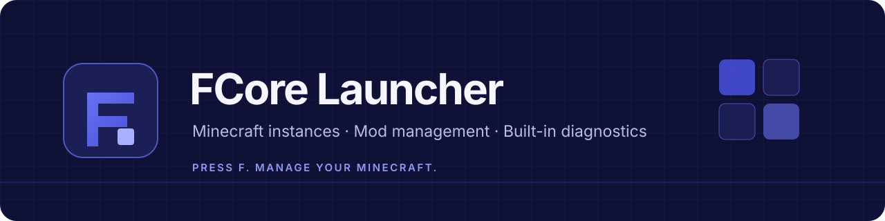

<p align="center">
  
</p>

<p align="center">
  <a href="https://github.com/MRBOMBOCLATTT/FCore-Launcher/releases"></a>
  <a href="https://github.com/MRBOMBOCLATTT/FCore-Launcher/stargazers"></a>
  <a href="https://github.com/MRBOMBOCLATTT/FCore-Launcher/issues"></a>
  <a href="https://github.com/MRBOMBOCLATTT/FCore-Launcher/commits/main"></a>
</p>

<p align="center">
  <strong>Лаунчер Minecraft, в котором сборки, моды и настройки собраны в одном месте.</strong>
</p>

<p align="center">
  <a href="https://github.com/MRBOMBOCLATTT/FCore-Launcher/releases">Скачать</a> ·
  <a href="#возможности">Возможности</a> ·
  <a href="#сборка-из-исходников">Сборка из исходников</a> ·
  <a href="#участие-в-разработке">Участие в разработке</a> ·
  <a href="#english">English</a>
</p>

---

## Что такое FCore Launcher?

**FCore Launcher** — настольный лаунчер Minecraft на Electron. Он помогает создавать отдельные сборки, управлять модами и игровым контентом, проверять совместимость перед запуском и обслуживать Minecraft без ручного копания в `.minecraft`.

Цель проекта — открытая разработка: после публикации исходного дерева в этом репозитории можно будет изучать код, сообщать об ошибках, предлагать функции и отправлять изменения.

## Возможности

### Сборки и запуск

- Отдельные моды, ресурспаки, шейдеры, миры и настройки для каждой сборки.
- Поддержка Vanilla, Fabric, Forge и NeoForge.
- Импорт и экспорт сборок в формате `.mrpack`.
- Перенос сборки на другую версию Minecraft с поиском доступных версий контента.
- Сравнение двух сборок и перенос выбранных модов между ними.
- Game Presets и Server Presets для разных сценариев запуска.

### Моды и контент

- Поиск и установка модов, ресурспаков и шейдеров через Modrinth и CurseForge.
- Управление зависимостями и граф связей между модами.
- Проверка сборки перед запуском: недостающие зависимости, неподходящие версии и потенциальные конфликты.
- Поиск одинаковых JAR по содержимому, а не только по имени файла.
- Mod Compatibility Watcher для поиска совместимых обновлений.
- Mod Groups и избранные моды.
- Профили ресурспаков.

### Диагностика и обслуживание

- Verify / Repair для проверки и восстановления файлов сборки.
- Анализ логов и крашей.
- Storage Analyzer для просмотра занятого места.
- Build Snapshots для сохранения и восстановления состояния сборки.
- Download Manager с прогрессом загрузок и историей операций.
- Performance Monitor для наблюдения за CPU и RAM процесса игры.
- Gaming Activity со статистикой игровых сессий.

### Аккаунты и удобство

- Авторизация Microsoft и Ely.by.
- Управление скинами и их предварительный просмотр.
- Discord Rich Presence.
- Автоматическая установка подходящей Java и проверка окружения.
- Светлая и тёмная темы, английский интерфейс и пользовательские шрифты.
- Галерея скриншотов и управление серверами.

> Набор функций зависит от версии лаунчера. Новые возможности сначала могут появляться в сборках разработки и только потом попадать в опубликованный релиз.

## Скачать

Готовые сборки публикуются на странице **[GitHub Releases](https://github.com/MRBOMBOCLATTT/FCore-Launcher/releases)**. Выбери последний опубликованный релиз и скачай установщик из его списка Assets.

[**Открыть страницу загрузок →**](https://github.com/MRBOMBOCLATTT/FCore-Launcher/releases/latest)

## Сборка из исходников

### Требования

- Node.js и npm.
- Git.
- Windows для использования `build.bat` и подготовки Windows-релиза.

### Запуск в режиме разработки

```bash
git clone https://github.com/MRBOMBOCLATTT/FCore-Launcher.git
cd FCore-Launcher
npm install
npm start
```

### Сборка приложения

```bash
npm run build
```

Команда использует `electron-builder` и параметры сборки, заданные в `package.json`.

### Тесты

```bash
npm test
```

Проверка переводов:

```bash
npm install --no-save jsdom
npm run i18n:check
```

## Структура проекта

| Путь | Назначение |
| --- | --- |
| `main.js`, `preload.js` | Главный процесс Electron и безопасный API для интерфейса |
| `src/` | Запуск Minecraft, аккаунты, загрузчики, моды, хранилище и сервисная логика |
| `renderer/` | Интерфейс лаунчера, стили, иконки и локализация |
| `tests/` | Автоматические тесты |
| `scripts/` | Скрипты обслуживания и публикации |
| `build/`, `resources/` | Ресурсы и файлы для сборки приложения |

## Участие в разработке

Идеи, сообщения об ошибках и pull request приветствуются.

Перед созданием issue:

1. Проверь, не описана ли проблема в [существующих Issues](https://github.com/MRBOMBOCLATTT/FCore-Launcher/issues).
2. Укажи версию FCore Launcher, версию Minecraft и загрузчик.
3. Добавь шаги воспроизведения и соответствующий фрагмент лога. Не прикладывай токены, пароли и другие секреты.

Для pull request:

1. Создай отдельную ветку от `main`.
2. Внеси одно логически связанное изменение.
3. Запусти `npm test`.
4. Опиши, что изменилось и как это проверить.

## Безопасность

- Не добавляй в репозиторий токены публикации, пароли и данные аккаунтов.
- Для публикации релизов используется переменная окружения `GH_TOKEN`; секреты не должны храниться в исходниках.
- Внешние данные (названия модов, описания и игровые логи) нужно безопасно обрабатывать перед выводом в интерфейс.
- Сообщая об уязвимости, не публикуй рабочий способ эксплуатации в открытом issue. Сначала свяжись с владельцем репозитория.

## Лицензия

FCore Launcher распространяется под лицензией **GNU General Public License v3.0 (GPL-3.0-only)**. Полный текст лицензии находится в файле [`LICENSE`](LICENSE).

Вы можете запускать программу, изучать её исходный код, изменять и распространять оригинальную программу и производные версии при соблюдении условий GPL-3.0. В частности, при распространении производной версии необходимо сохранить уведомления об авторстве и лицензии и предоставить соответствующий исходный код на условиях этой лицензии.

Сторонние библиотеки, ресурсы и другие компоненты сохраняют собственные лицензии. Перед распространением сборки проверьте их условия и уведомления.

---

## English

**FCore Launcher** is an Electron desktop launcher for Minecraft. It organizes separate game instances, mods, resource packs, shaders and worlds, and provides compatibility checks and maintenance tools.

Highlights include instance management, Modrinth and CurseForge integration, dependency checks, build comparison, snapshots, download history, activity statistics, mod groups, favorites, resource-pack profiles and performance monitoring.

- **Downloads:** [GitHub Releases](https://github.com/MRBOMBOCLATTT/FCore-Launcher/releases)
- **Issues:** [Report a bug or request a feature](https://github.com/MRBOMBOCLATTT/FCore-Launcher/issues)
- **Build:** `npm install`, then `npm start`
- **Tests:** `npm test`

FCore Launcher is licensed under the **GNU General Public License v3.0 (GPL-3.0-only)**. See [`LICENSE`](LICENSE) for the complete license text. Redistributed copies and derivative works must comply with GPL-3.0, including its source-code and notice requirements. Third-party libraries and assets remain under their respective licenses.
