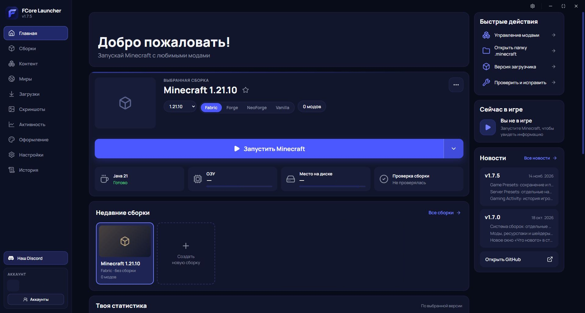
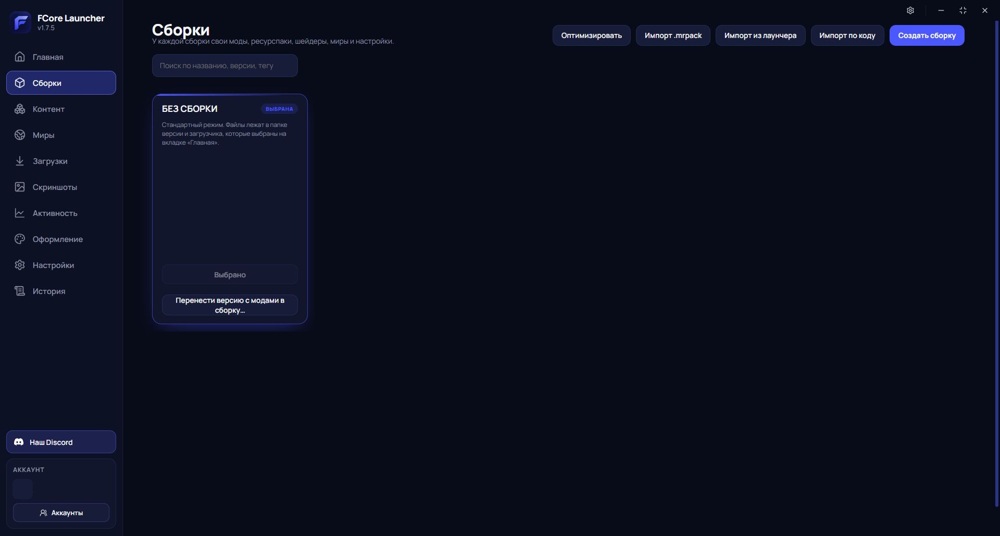
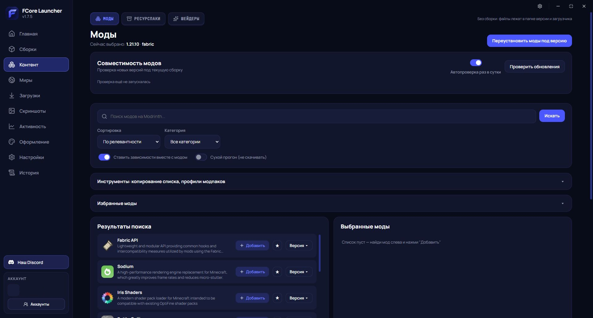

<p align="center">
  
</p>

<p align="center">
  <a href="https://github.com/MRBOMBOCLATTT/FCore-Launcher/releases"></a>
  <a href="https://github.com/MRBOMBOCLATTT/FCore-Launcher/stargazers"></a>
  <a href="https://github.com/MRBOMBOCLATTT/FCore-Launcher/issues"></a>
  <a href="https://github.com/MRBOMBOCLATTT/FCore-Launcher/commits/main"></a>
  
</p>

<p align="center">
  <strong>Лаунчер Minecraft, в котором сборки, моды и настройки собраны в одном месте.</strong>
</p>

<p align="center">
  <a href="https://github.com/MRBOMBOCLATTT/FCore-Launcher/releases/latest">Скачать</a> ·
  <a href="#возможности">Возможности</a> ·
  <a href="#установка">Установка</a> ·
  <a href="#быстрый-старт">Быстрый старт</a> ·
  <a href="#частые-вопросы">Вопросы</a> ·
  <a href="#сборка-из-исходников">Сборка из исходников</a> ·
  <a href="README.md">English</a>
</p>

---



## Что такое FCore Launcher?

**FCore Launcher** — настольный лаунчер Minecraft на Electron. Вместо ручного копания в `.minecraft` ты создаёшь отдельные **сборки**: у каждой свои моды, ресурспаки, шейдеры, миры и настройки. Лаунчер сам ставит нужную Java, проверяет моды перед запуском и помогает обслуживать игру.

Поддерживаются **Vanilla, Fabric, Forge и NeoForge**, поиск по **Modrinth и CurseForge**. Исходный код открыт под GPL-3.0.

Интерфейс доступен на **русском и английском**.

## Скриншоты

| Сборки | Контент |
| --- | --- |
|  |  |

## Возможности

### Сборки и запуск

- Отдельные моды, ресурспаки, шейдеры, миры и настройки для каждой сборки.
- Поддержка Vanilla, Fabric, Forge и NeoForge.
- Импорт и экспорт сборок в формате `.mrpack`.
- Перенос сборки на другую версию Minecraft с поиском доступных версий контента.
- Сравнение двух сборок и перенос выбранных модов между ними.
- Game Presets и Server Presets для разных сценариев запуска.

### Моды и контент

- Поиск и установка модов, ресурспаков и шейдеров через Modrinth и CurseForge.
- Управление зависимостями и граф связей между модами.
- Проверка сборки перед запуском: недостающие зависимости, неподходящие версии и потенциальные конфликты.
- Поиск одинаковых JAR по содержимому, а не только по имени файла.
- Mod Compatibility Watcher для поиска совместимых обновлений.
- Группы модов, избранные моды и профили ресурспаков.

### Диагностика и обслуживание

- Verify / Repair для проверки и восстановления файлов сборки.
- Анализ логов и крашей.
- Storage Analyzer для просмотра занятого места.
- Build Snapshots для сохранения и восстановления состояния сборки.
- Download Manager с прогрессом загрузок и историей операций.
- Performance Monitor для наблюдения за CPU и RAM процесса игры.
- Gaming Activity со статистикой игровых сессий.

### Аккаунты и удобство

- Авторизация Microsoft и Ely.by.
- Управление скинами и их предварительный просмотр.
- Discord Rich Presence.
- Автоматическая установка подходящей Java и проверка окружения.
- Светлая и тёмная темы, русский и английский интерфейс, пользовательские шрифты.
- Галерея скриншотов и управление серверами.

> Набор функций зависит от версии лаунчера. Новые возможности сначала могут появляться в сборках разработки и только потом попадать в опубликованный релиз.

## Установка

### Требования

- Windows 10 или 11 (64-бит).
- Интернет при первом запуске: лаунчер скачивает Minecraft, загрузчик модов и Java.
- Аккаунт Minecraft. Поддерживаются аккаунты Microsoft и Ely.by.
- Java ставить **не нужно**: FCore Launcher сам скачает подходящую версию.

### Шаги

1. Открой страницу [Releases](https://github.com/MRBOMBOCLATTT/FCore-Launcher/releases/latest).
2. В разделе **Assets** скачай установщик (файл `.exe`).
3. Запусти его и следуй шагам установщика.
4. Открой **FCore Launcher** из меню «Пуск» или с ярлыка на рабочем столе.

> **Windows SmartScreen:** если Windows пишет «Система Windows защитила ваш компьютер», нажми **Подробнее → Выполнить в любом случае**. Такое сообщение появляется у многих программ независимых разработчиков. Если не доверяешь, можно прочитать исходный код и [собрать лаунчер сам](#сборка-из-исходников).

## Быстрый старт

1. **Войди в аккаунт.** Нажми **Аккаунты** в левом нижнем углу и добавь аккаунт Microsoft или Ely.by.
2. **Выбери версию.** На вкладке **Главная** выбери версию Minecraft и загрузчик (Fabric, Forge, NeoForge или Vanilla).
3. **Создай сборку** (необязательно, но удобно). Открой **Сборки → Создать сборку**, назови её и выбери версию и загрузчик. У каждой сборки свои моды, миры и настройки, поэтому эксперименты не сломают основную игру.
4. **Добавь моды.** Открой **Контент**, найди мод и нажми **Добавить**. Зависимости ставятся вместе с модом.
5. **Запусти игру.** Нажми **Запустить Minecraft**. Лаунчер сначала проверит сборку и доустановит недостающее.

Уже есть готовая сборка? На вкладке «Сборки» есть **Импорт .mrpack**, **Импорт из лаунчера** и **Импорт по коду**.

## Частые вопросы

**Нужно ли ставить Java?**
Нет, лаунчер сам установит подходящую.

**Где хранятся файлы?**
В папке игры. Открыть её можно через **Главная → Быстрые действия → Открыть папку .minecraft**. У каждой сборки своя подпапка, названная по имени сборки.

**Как перенести уже установленные моды в сборку?**
На вкладке «Сборки» у карточки «Без сборки» есть кнопка **Перенести версию с модами в сборку…**.

**Работает ли CurseForge?**
Да, вместе с Modrinth. Доступность некоторых файлов CurseForge зависит от настроек распространения у авторов.

**Есть ли версия для macOS или Linux?**
Релизы сейчас публикуются для Windows. Код написан на Electron, поэтому можно попробовать запустить из исходников на других системах, но официально это не проверялось.

**Что-то сломалось. Как сообщить?**
Создай [issue](https://github.com/MRBOMBOCLATTT/FCore-Launcher/issues) и укажи версию лаунчера, версию Minecraft, загрузчик, шаги воспроизведения и фрагмент лога. Токены и пароли не прикладывай.

## Сборка из исходников

### Требования

- Node.js и npm.
- Git.
- Windows для `build.bat` и подготовки Windows-релиза.

### Запуск в режиме разработки

```bash
git clone https://github.com/MRBOMBOCLATTT/FCore-Launcher.git
cd FCore-Launcher
npm install
npm start
```

### Сборка приложения

```bash
npm run build
```

Команда использует `electron-builder` и параметры сборки из `package.json`.

### Тесты

```bash
npm test
```

Проверка переводов:

```bash
npm install --no-save jsdom
npm run i18n:check
```

## Структура проекта

| Путь | Назначение |
| --- | --- |
| `main.js`, `preload.js` | Главный процесс Electron и безопасный API для интерфейса |
| `src/` | Запуск Minecraft, аккаунты, загрузчики, моды, хранилище и сервисная логика |
| `renderer/` | Интерфейс лаунчера, стили, иконки и локализация |
| `tests/` | Автоматические тесты |
| `scripts/` | Скрипты обслуживания и публикации |
| `build/`, `resources/` | Ресурсы и файлы для сборки приложения |

## Участие в разработке

Идеи, сообщения об ошибках и pull request приветствуются.

Перед созданием issue:

1. Проверь, не описана ли проблема в [существующих Issues](https://github.com/MRBOMBOCLATTT/FCore-Launcher/issues).
2. Укажи версию FCore Launcher, версию Minecraft и загрузчик.
3. Добавь шаги воспроизведения и фрагмент лога. Не прикладывай токены, пароли и другие секреты.

Для pull request:

1. Создай отдельную ветку от `main`.
2. Внеси одно логически связанное изменение.
3. Запусти `npm test`.
4. Опиши, что изменилось и как это проверить.

## Безопасность

- Не добавляй в репозиторий токены публикации, пароли и данные аккаунтов.
- Для публикации релизов используется переменная окружения `GH_TOKEN`; секреты не должны храниться в исходниках.
- Внешние данные (названия модов, описания и игровые логи) нужно безопасно обрабатывать перед выводом в интерфейс.
- Если нашёл уязвимость, не публикуй рабочий способ эксплуатации в открытом issue. Сначала свяжись с владельцем репозитория.

## Лицензия

FCore Launcher распространяется под лицензией **GNU General Public License v3.0 (GPL-3.0-only)**. Полный текст лицензии находится в файле [`LICENSE`](LICENSE).

Ты можешь запускать программу, изучать её исходный код, изменять и распространять оригинальную программу и производные версии при соблюдении условий GPL-3.0. При распространении производной версии нужно сохранить уведомления об авторстве и лицензии и предоставить соответствующий исходный код на условиях этой лицензии.

Сторонние библиотеки, ресурсы и другие компоненты сохраняют собственные лицензии. Перед распространением сборки проверьте их условия.

FCore Launcher не является официальным продуктом Minecraft и не связан с Mojang или Microsoft.
